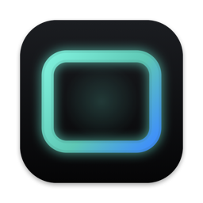
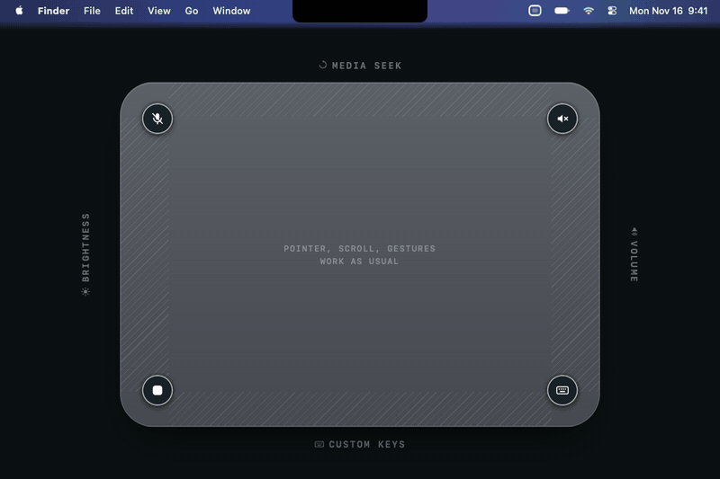
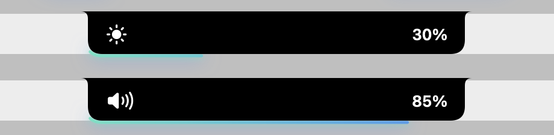
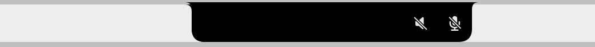
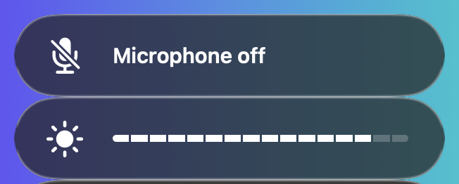
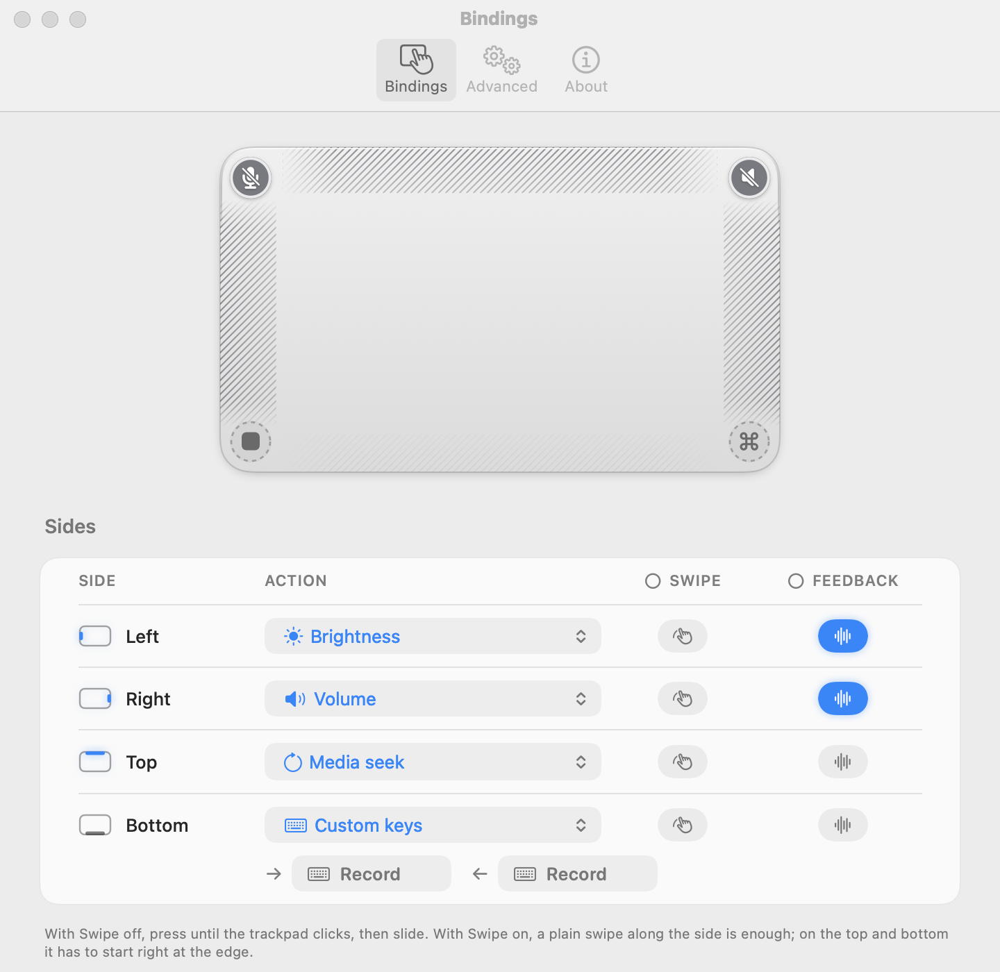
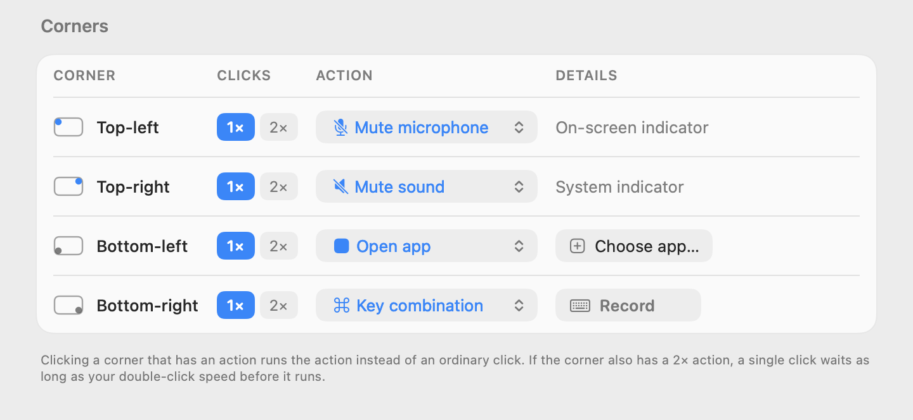
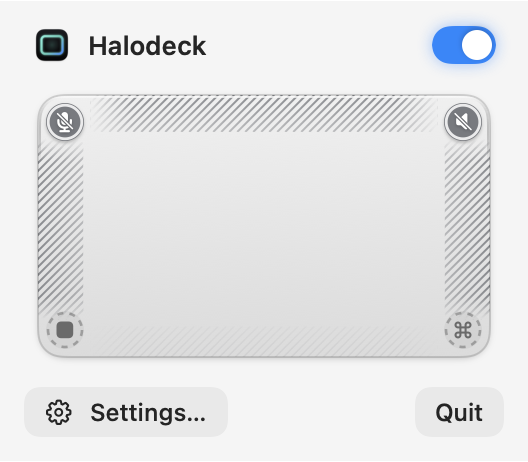

<p align="center">
  
</p>

<h1 align="center">Halodeck</h1>

<p align="center">Use the sides of your trackpad as sliders and its corners as buttons.</p>

<p align="center">
  <a href="https://github.com/disc/halodeck/releases/latest"><b>Download</b></a>
  &nbsp;·&nbsp;
  <code>brew install --cask disc/tap/halodeck</code>
</p>

<p align="center"><sub>macOS 14 or later · Apple silicon · Free and open source</sub></p>

<br>

<p align="center">
  
</p>

Halodeck is a small menu-bar app that turns a narrow strip along each side of the trackpad into a
slider and each corner into a button. Press down near the right side and slide up, and the volume
goes up. Do the same on the left for brightness. Click the top-right corner to turn the sound off.

The rest of the trackpad works as before. A plain click is still a click, and a side reacts only
when you press it and then slide, so moving the pointer near the side doesn't change anything. If
you'd rather slide without pressing, you can turn that on for each side separately.

On a MacBook with a notch, Halodeck shows the level in the notch itself. On other Macs it shows it in
a small pill under the menu bar.

## What it does

- **Sides.** Each side can control the volume, the display brightness, the keyboard light, media
  seek (the ← and → keys), the previous or next track, browser tabs (⌃Tab and ⌃⇧Tab), or two
  shortcuts of your own, one for each direction. Out of the box the right side is volume, the left
  is brightness, the top is media seek and the bottom waits for your shortcuts.
- **Corners.** A click in a corner can mute the sound or the microphone, press a key combination,
  open an app (click again to hide it), open a link, run a Shortcut, lock the screen, or show
  Mission Control, the app's windows, the desktop or Apps. A double click can run a second action.
  The top-left corner mutes the microphone and the top-right one the sound; the bottom two are yours
  to set.
- **Steps.** One step for every 4 mm you slide, a sixteenth of the range, the same as the volume
  keys. Hold Option for steps four times smaller, or Shift to jump by eighths.
- **Feedback.** The trackpad gives a light haptic tap on every step, and you can add a short sound
  whose pitch follows the level. At 0% and 100% the taps stop and the notch gives a small bump, so
  you can tell you've reached the end.
- **Mute signs.** While the sound or the microphone is off, a small crossed-out icon stays next to
  the notch, so you don't forget about it.

<p align="center">
  
</p>
<p align="center"><sub>The level as a light under the notch.</sub></p>

<p align="center">
  
</p>
<p align="center"><sub>Sound and microphone off.</sub></p>

<p align="center">
  
</p>
<p align="center"><sub>A corner click.</sub></p>

<p align="center">
  
</p>
<p align="center"><sub>On a Mac without a notch.</sub></p>

<p align="center">
  
</p>
<p align="center"><sub>Settings: click a side or a corner on the map to change what it does.</sub></p>

<details>
<summary>More screenshots</summary>
<br>
<p align="center">
  
  
</p>
</details>

## Install

### Homebrew

```sh
brew install --cask disc/tap/halodeck
```

Update it with `brew upgrade --cask halodeck`.

### Manual download

1. Download the ZIP from [Releases](https://github.com/disc/halodeck/releases/latest).
2. Unzip it and move `Halodeck.app` to `/Applications`.
3. Open Halodeck. It lives in the menu bar and has no Dock icon.
4. Allow it in **System Settings › Privacy & Security › Accessibility**.

A downloaded copy updates itself. You can turn the update check off in **Settings › About**.

Releases are signed with Developer ID and notarized by Apple.

## Why it needs Accessibility

To tell a click on a side from an ordinary click, Halodeck has to see the trackpad's clicks before
the app under the pointer does, and to change the volume or press your shortcuts it sends key
presses. macOS allows both only to apps you've added to the Accessibility list.

It reads the finger positions through Apple's private MultitouchSupport framework.

## Privacy

Halodeck doesn't collect anything and has no analytics. The only thing it sends over the network is
the update check of a downloaded copy, which asks GitHub whether there's a new release.

## License

MIT. See [LICENSE](LICENSE).
